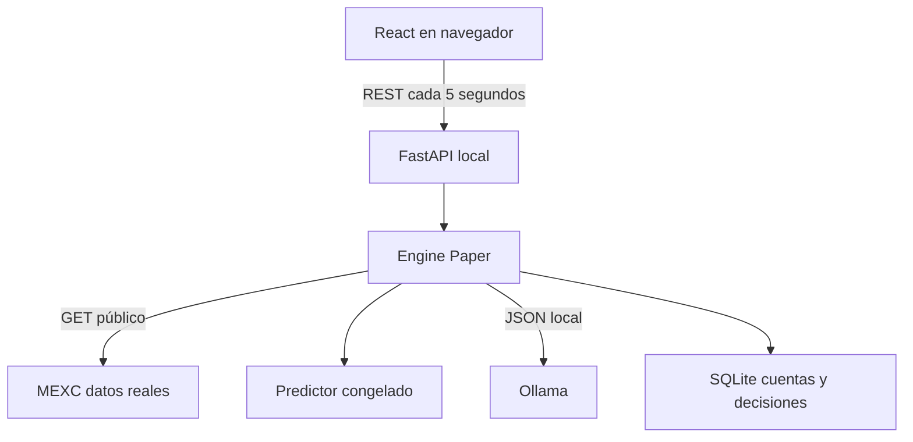
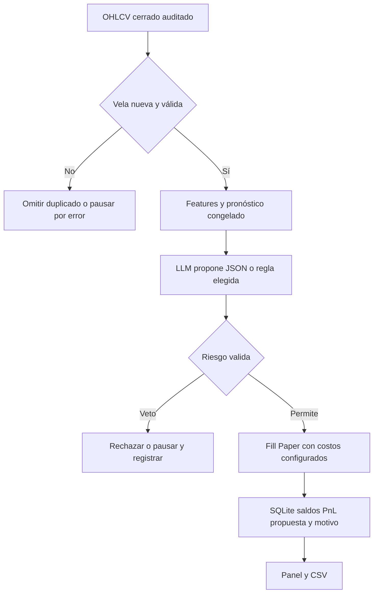

# Arquitectura y flujo de decisión

## Componentes reales

No hay WebSocket ni broker de órdenes de exchange. Live significa datos actuales con ejecución virtual. El navegador no consulta MEXC directamente. El scheduler ejecuta una consulta por minuto; las decisiones usan una vela diaria cerrada y una clave única por libro y vela.

## Decisión trazable

El motor revalida STOP y modo antes de guardar la operación. El LLM no llama al exchange, calcula tamaños ni cambia los límites. Un error de red o contrato pausa; no se continúa con otra estrategia automáticamente. La tabla de rutas está en README.md y FastAPI expone /docs.
